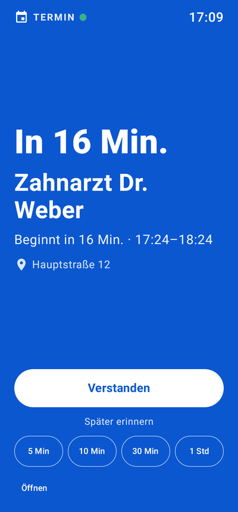
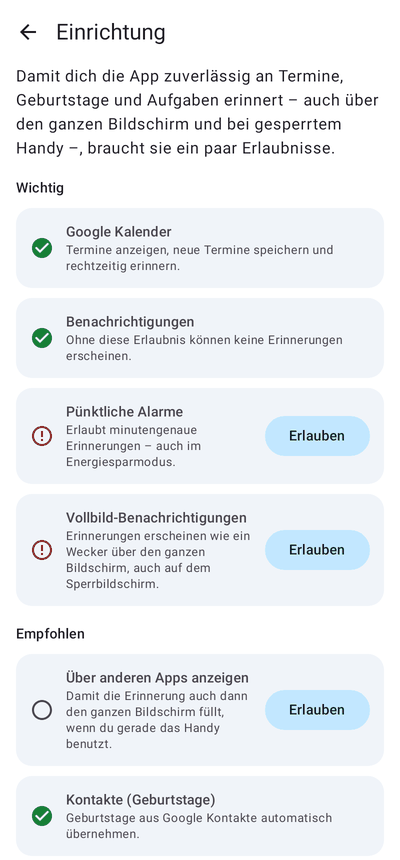

# ADHS App

Android-App, die dich an **Termine, Geburtstage und Aufgaben** erinnert – **über den ganzen Bildschirm**, wie ein Wecker.
Dazu: dein **Google Kalender** im gewohnten Google-Look und deine **Google-Health-Daten** (Schritte, Schlaf, Ruhepuls).

| Heute | Kalender | Woche | Vollbild-Erinnerung |
|---|---|---|---|
|  |  |  |  |

| Aufgaben | Geburtstage | Gesundheit | Einrichtung |
|---|---|---|---|
|  |  |  |  |

Weitere Bilder: [Monat](docs/screenshots/06-kalender-monat.png), [3 Tage](docs/screenshots/05-kalender-3-tage.png), [Vollbild Aufgabe](docs/screenshots/11-vollbild-aufgabe.png).

## Was die App kann

**Heute** – der Startbildschirm gegen Zeitblindheit
- „Als Nächstes“ mit großem Countdown („In 1 Std. 11 Min.“) und „Jetzt“-Anzeige mit Fortschrittsbalken
- Termine von heute, Aufgaben für heute (mit Schnell-Eingabe), Geburtstage der nächsten 14 Tage, Schritte und Schlaf

**Kalender** – im Stil von Google Kalender
- Ansichten: Terminübersicht, Tag, 3 Tage, Woche, Monat (wischen zum Blättern, „Heute“-Knopf, Datumsauswahl)
- Seitenmenü mit allen Google-Kalendern zum Ein-/Ausblenden, Kalenderfarben, rote Jetzt-Linie
- Termine anlegen, bearbeiten und löschen – landen direkt in deinem Google Kalender
- Tippen ins Raster legt einen Termin zu dieser Uhrzeit an

**Erinnerungen über den ganzen Bildschirm**
- Gesperrtes Handy: die Erinnerung schaltet das Display ein und erscheint wie ein Wecker
- Entsperrtes Handy: mit der Erlaubnis „Über anderen Apps anzeigen“ ebenfalls im Vollbild
- Weckton und Vibration (bis zur Bestätigung, einstellbar), großer Countdown, „Verstanden“, „Erledigt“, „Später erinnern“ (5/10/30/60 Min.)
- Termine: frei wählbare Vorwarnungen (z. B. 15 Min. vorher **und** zu Beginn) plus die Erinnerungen aus Google Kalender
- Geburtstage: am Tag und/oder 1/3/7 Tage vorher (für Geschenke)
- Aufgaben: zur Fälligkeit; wiederkehrende Aufgaben (täglich, werktags, wöchentlich, monatlich) – ideal für Medikamente
- Verpasste Erinnerungen (Handy war aus) kommen nach, solange der Termin noch läuft
- „Test-Erinnerung in 10 Sekunden“ in Einstellungen und Einrichtung

**Aufgaben**
- Überfällig / Heute / Morgen / Demnächst / Ohne Datum, Fortschrittsbalken „3 von 5 geschafft“
- Überfälliges mit einem Tipp „Auf morgen verschieben“
- Optionaler Abgleich mit **Google Tasks**

**Geburtstage**
- Automatisch aus deinen Google-Kontakten, zusätzlich eigene Einträge, Alter wird angezeigt

**App-Updates direkt aus GitHub**
- Neue Versionen erscheinen nach jedem Merge auf `main` automatisch als GitHub-Release
- Die App meldet ein Update sofort beim Öffnen (Dialog) bzw. im Hintergrund (Benachrichtigung)
  und installiert es automatisch oder nach deiner Bestätigung

**Gesundheit** (Google Health API)
- Schritte heute mit Ziel-Ring, 7-Tage-Verlauf, Strecke, Aktivzonenminuten, Kalorien
- Schlaf der letzten Nacht mit Schlafphasen, Schlafdauer der letzten 7 Nächte, Ruhepuls
- Freundliche Tipps, z. B. nach einer kurzen Nacht

## Installation

### Variante A: fertige APK aus GitHub (empfohlen)
1. Im Repository unter **Releases** die neueste Version öffnen und `adhs-app.apk` herunterladen.
2. Auf dem Handy öffnen und installieren („Installation aus unbekannten Quellen“ erlauben).
3. Ab jetzt aktualisiert sich die App selbst (siehe [App-Updates](#app-updates)).

Testversionen aus Pull Requests gibt es unter **Actions → Android → Artefakt adhs-app-debug-apk**
(anders signiert, daher nicht als Update über eine Release-Version installierbar).

### Variante B: selbst bauen
Android Studio öffnen → Projekt öffnen → ▶ Run. Oder im Terminal:

```bash
./gradlew assembleDebug        # APK: app/build/outputs/apk/debug/app-debug.apk
./gradlew testDebugUnitTest    # Unit-Tests
```

Voraussetzungen: JDK 17+, Android SDK 36. Mindestens Android 8.0 auf dem Handy.

## Einrichtung auf dem Handy

Beim ersten Start öffnet sich die **Einrichtung**. Für zuverlässige Vollbild-Erinnerungen:

| Erlaubnis | Warum |
|---|---|
| Kalender | Google-Kalender anzeigen und Termine speichern |
| Benachrichtigungen | Ohne sie erscheinen keine Erinnerungen |
| Pünktliche Alarme | Minutengenaue Erinnerungen, auch im Energiesparmodus |
| Vollbild-Benachrichtigungen | Ab Android 14 nötig, damit Erinnerungen den Bildschirm füllen |
| Über anderen Apps anzeigen | Vollbild auch, wenn du das Handy gerade benutzt |
| Kontakte | Geburtstage aus Google Kontakte |
| Akku-Optimierung aus | Damit Android die App nicht „schlafen legt“ |

Danach unbedingt **„Test-Erinnerung in 10 Sekunden“** drücken und das Handy sperren.
Bei Samsung, Xiaomi, Huawei & Co. zusätzlich die Hersteller-Energiesparfunktionen für die App ausschalten
(Anleitungen je Hersteller: <https://dontkillmyapp.com>).

**Google Kalender** braucht keine weitere Einrichtung: Die App nutzt die Kalender, die dein Google-Konto
ohnehin auf dem Handy synchronisiert. Kontrolle: *Einstellungen → Konten → Google → Kontosynchronisierung → Google Kalender* ist an.

## Google Health und Google Tasks verbinden (einmalig)

Google gibt Gesundheitsdaten und Aufgaben nur an Apps heraus, die in der Google Cloud registriert sind.
Für eine private App dauert das etwa 10 Minuten:

1. **Projekt anlegen:** <https://console.cloud.google.com> → oben „Projekt auswählen“ → „Neues Projekt“ (z. B. „ADHS App“).
2. **APIs aktivieren:** *APIs & Dienste → Bibliothek* → **Google Health API** aktivieren, ebenso **Google Tasks API**
   (nur nötig, wenn du Google Tasks nutzen willst).
3. **Zustimmungsbildschirm** (*Google Auth Platform*, früher „OAuth-Zustimmungsbildschirm“):
   - Zielgruppe **Extern**, App-Name „ADHS App“, deine E-Mail als Support-Kontakt.
   - Unter **Datenzugriff** diese Bereiche hinzufügen:
     - `https://www.googleapis.com/auth/googlehealth.activity_and_fitness.readonly`
     - `https://www.googleapis.com/auth/googlehealth.sleep.readonly`
     - `https://www.googleapis.com/auth/googlehealth.health_metrics_and_measurements.readonly`
     - `https://www.googleapis.com/auth/tasks` (für Google Tasks)
   - Unter **Zielgruppe → Testnutzer** deine eigene Gmail-Adresse eintragen.
4. **Android-Client anlegen:** *Clients → Client erstellen → Android*
   - Paketname: `de.lltntplanet.adhsapp`
   - SHA-1-Fingerabdruck deiner App:
     - selbst gebaut: `./gradlew :app:signingReport` → Zeile `SHA1` bei `Variant: debug`
     - APK aus einem GitHub-Release: steht im Log des Release-Laufs im Schritt „Signatur prüfen“.
     - APK aus GitHub Actions (Testversion): steht im Log im Schritt „SHA-1 für den Android-OAuth-Client anzeigen“.
       Damit der Fingerabdruck bei jedem Build gleich bleibt, einen eigenen Debug-Keystore als Secret
       `DEBUG_KEYSTORE_BASE64` hinterlegen (`base64 -w0 ~/.android/debug.keystore`).
5. In der App: **Gesundheit → Mit Google verbinden** bzw. **Einstellungen → Google Tasks → Verbinden**.

Hinweise:
- Ein Client-Secret oder API-Key in der App ist **nicht** nötig – Google erkennt die App am Paketnamen und SHA-1.
- Fehler 10 bei der Anmeldung bedeutet fast immer: Paketname oder SHA-1 im Android-Client stimmen nicht.
- Im Status „Testen“ kann Google die Freigabe nach einigen Tagen verfallen lassen. Dann zeigt die App
  „Google Health neu verbinden“ – einmal tippen genügt.
- Die Google Health API ist der Nachfolger der Fitbit Web API. Daten von Fitbit, Pixel Watch und verbundenen Apps
  erscheinen, sobald sie in deinem Google-Konto (Google Health / Fitbit-App mit Google-Konto) liegen.

## App-Updates

Nach jedem Merge auf `main` baut GitHub Actions (`.github/workflows/release.yml`) eine signierte APK und
veröffentlicht sie als Release `v1.0.<Nummer>`. Die App sucht beim Öffnen (höchstens stündlich) und im
Hintergrund (alle 4 Stunden) nach einer neueren Version:

- **App offen:** Ein Dialog fragt sofort „Neue Version verfügbar – jetzt aktualisieren?“.
- **Im Hintergrund:** Mit „Updates automatisch installieren“ (Standard) lädt und installiert die App das
  Update selbst. Das allererste Mal fragt Android zur Sicherheit nach; danach geht es ab Android 12 ohne
  Rückfrage. Sonst kommt eine Benachrichtigung zum Bestätigen.
- Vor der Installation prüft die App Prüfsumme, Paketname, Versionsnummer und Signatur.

### Einmalige Einrichtung

1. **Signaturschlüssel als Secrets:** Im Repository *Settings → Secrets and variables → Actions →
   New repository secret* zwei Secrets anlegen:
   - `SIGNING_KEYSTORE_BASE64`: der Schlüssel (PKCS12, Alias `adhs`) als Base64-Text
   - `SIGNING_PASSWORD`: sein Passwort (für Schlüsselspeicher und Schlüssel gleich)

   Selbst erzeugen (am PC mit Java):
   ```bash
   keytool -genkeypair -keystore release.p12 -storetype PKCS12 -alias adhs -keyalg RSA -keysize 4096 \
     -validity 36500 -dname "CN=ADHS App"
   base64 -w0 release.p12    # Ausgabe in SIGNING_KEYSTORE_BASE64 einfügen
   ```
   Alle Versionen müssen mit diesem Schlüssel signiert sein, sonst lehnt Android Updates ab –
   Schlüssel und Passwort gut aufbewahren. Der Schlüssel gehört nie ins Repository.
2. **Nur bei privatem Repository → Token in der App:** *Einstellungen → App-Updates → Token erstellen* öffnet GitHub
   mit vorausgefülltem Formular (nur Lesezugriff auf Inhalte). Dort unter *Repository access* „Only select
   repositories“ → `ADHS-App` wählen, Token erzeugen, kopieren und in der App einfügen → *Speichern*.
   Ist das Repository öffentlich (wie `llTNTPlanet/ADHS-App`), braucht es keinen Token.
3. **„Unbekannte Apps installieren“** für ADHS App erlauben (die App fragt beim ersten Update danach).
4. **Einmalig umsteigen:** Eine Testversion aus *Actions* ist mit einem anderen Schlüssel signiert. Diese einmal
   deinstallieren und die APK aus dem ersten Release installieren – danach kommen alle Updates automatisch.
5. **Google Health/Tasks:** Im Android-OAuth-Client der Google Cloud Console den SHA-1 des Release-Schlüssels
   eintragen (zusätzlicher Android-Client oder SHA-1 ersetzen). Er steht im Log jedes Release-Laufs im
   Schritt „Signatur prüfen“.

## Datenschutz

Alles bleibt auf deinem Handy. Kalender und Kontakte werden aus dem Google-Konto auf dem Gerät gelesen,
Gesundheitsdaten werden nur gelesen und lokal zwischengespeichert. Es gibt keinen eigenen Server und keine Analyse-Tools.
Der GitHub-Token für Updates liegt im privaten App-Speicher und ist von Geräte-Backups ausgenommen.

## Technik

- Kotlin, Jetpack Compose (Material 3), Room, DataStore, WorkManager
- Google Kalender über den Kalender-Speicher von Android (`CalendarContract`) – offline-fähig, keine Cloud-Freigabe nötig
- Google Health API v4 (`health.googleapis.com`) und Google Tasks API über `AuthorizationClient` (Google Identity Services) und OkHttp
- Erinnerungen: genau ein exakter Alarm auf die jeweils nächste Erinnerung (`AlarmManager`), Benachrichtigung mit
  Full-Screen-Intent, Vollbild-Activity über dem Sperrbildschirm; Neuplanung nach Neustart, Zeitänderung,
  Kalender-/Kontaktänderungen und alle 30 Minuten als Sicherheitsnetz
- Daten-Aktualisierung (`DataRefresher`): Google Health, Google Tasks, Termine, Geburtstage und die Erinnerungsplanung
  werden zentral neu geladen – alle 5 Minuten im Hintergrund (`RefreshWorker`, reiht sich selbst neu ein, weil
  WorkManager periodische Jobs erst ab 15 Minuten erlaubt), beim Öffnen der App und danach alle 5 Minuten, solange sie
  sichtbar ist, sowie manuell durch Herunterziehen auf jedem Bildschirm (Pull-to-Refresh). Im Energiesparmodus (Doze)
  fasst Android Hintergrundläufe zusammen, dann vergehen auch mal 15 Minuten oder mehr.

```
app/src/main/java/de/lltntplanet/adhsapp/
├── data/          Kalender, Geburtstage, Aufgaben (Room), Einstellungen, Google-APIs, Gesundheit
├── reminders/     Planung, Alarme, Benachrichtigung, Vollbild-Activity, Hintergrund-Jobs
├── update/        Selbst-Update aus GitHub-Releases (Prüfung, Download, Installation)
├── ui/            Heute, Kalender, Aufgaben, Geburtstage, Gesundheit, Einstellungen, Einrichtung
└── util/          Zeitformate (deutsch), Berechtigungen
```

Screenshots neu erzeugen (Robolectric, ohne Emulator):

```bash
./gradlew testDebugUnitTest -Pscreenshots=true --tests "*ScreenshotTest*"   # → app/build/screenshots/
```

## Bekannte Grenzen

- Wiederkehrende Termine werden in der App angezeigt; ändern lassen sie sich über „In Google Kalender öffnen“.
- Google Tasks speichert nur ein Datum, keine Uhrzeit – Uhrzeit, Erinnerung und „wichtig“ bleiben in der App.
  Wiederkehrende Aufgaben bleiben lokal, weil die Google-Tasks-API keine Wiederholungen kennt.
