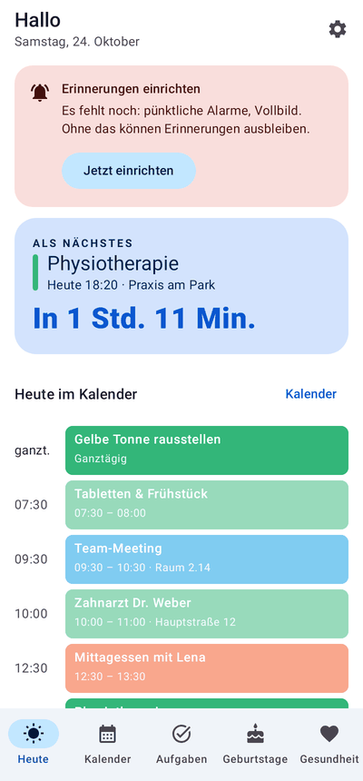
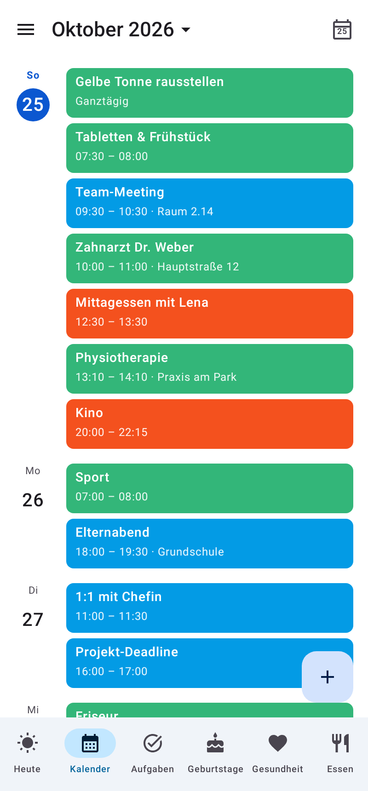
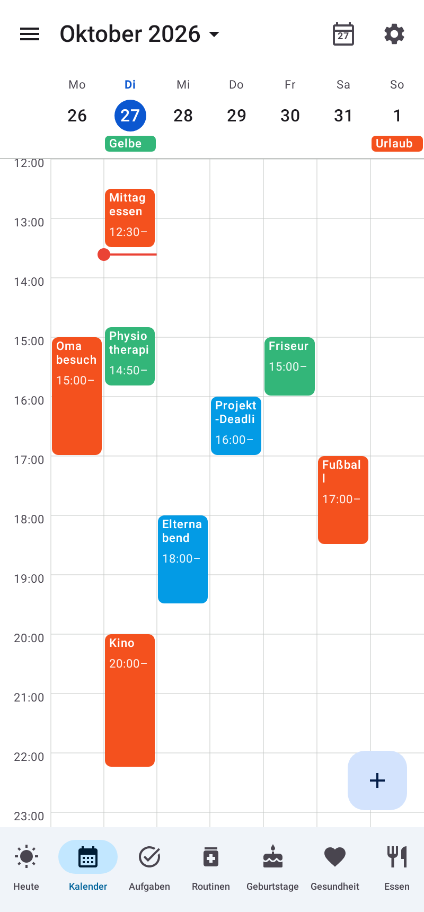
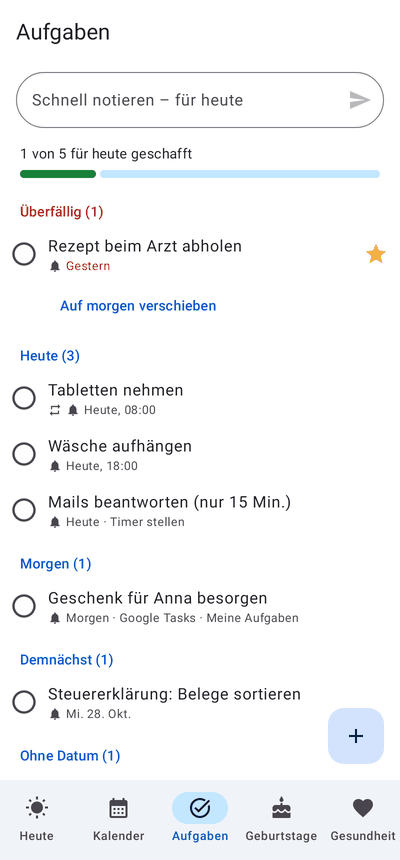
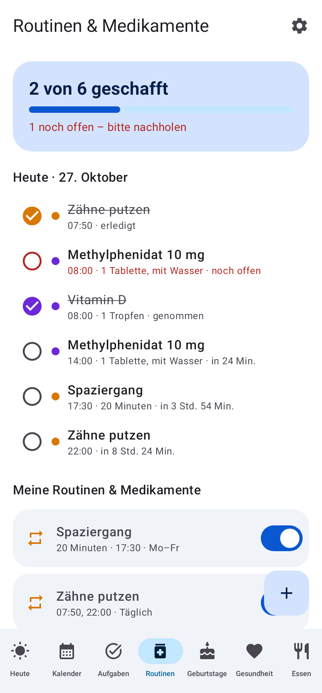
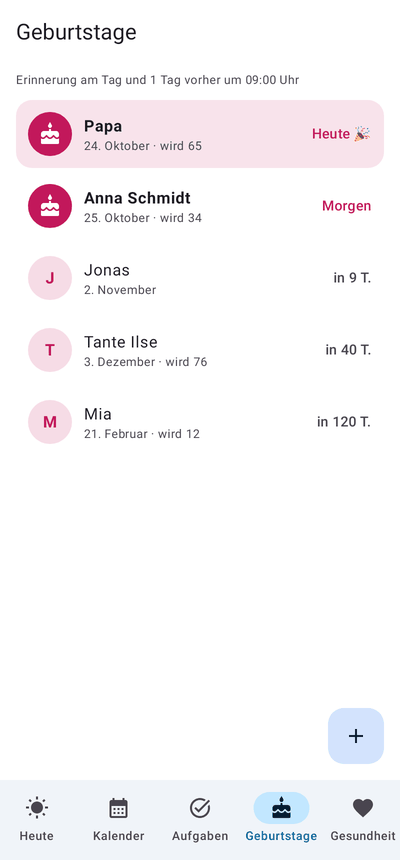
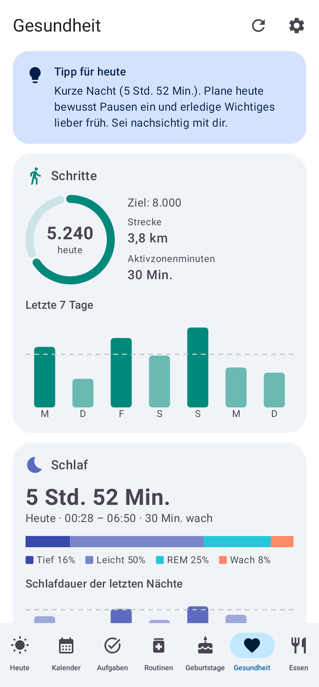

# ADHS App

Android-App, die dich an **Termine, Geburtstage und Aufgaben** erinnert – **über den ganzen Bildschirm**, wie ein Wecker.
Dazu: dein **Google Kalender** im gewohnten Google-Look und deine **Google-Health-Daten** (Schritte, Schlaf, Ruhepuls).

| Heute | Kalender | Woche | Vollbild-Erinnerung |
|---|---|---|---|
|  |  |  |  |

| Aufgaben | Routinen & Medikamente | Geburtstage | Gesundheit |
|---|---|---|---|
|  |  |  |  |

Weitere Bilder: [Einrichtung](docs/screenshots/01-einrichtung.png), [Essen](docs/screenshots/10-ernaehrung.png), [Monat](docs/screenshots/06-kalender-monat.png), [3 Tage](docs/screenshots/05-kalender-3-tage.png), [Vollbild Aufgabe](docs/screenshots/12-vollbild-aufgabe.png), [Leiste mit „Weitere“](docs/screenshots/14-weitere.png).

## Was die App kann

**Heute** – der Startbildschirm gegen Zeitblindheit
- „Als Nächstes“ mit großem Countdown („In 1 Std. 11 Min.“) und „Jetzt“-Anzeige mit Fortschrittsbalken
- Termine von heute, die nächsten zwei Routinen/Medikamente zum Abhaken, Aufgaben für heute (mit Schnell-Eingabe),
  Geburtstage der nächsten 14 Tage, Schritte und Schlaf

**Kalender** – im Stil von Google Kalender
- Ansichten: Terminübersicht, Tag, 3 Tage, Woche, Monat (wischen zum Blättern, „Heute“-Knopf, Datumsauswahl)
- Seitenmenü mit allen Google-Kalendern zum Ein-/Ausblenden, Kalenderfarben, rote Jetzt-Linie
- Termine anlegen, bearbeiten und löschen – landen direkt in deinem Google Kalender
- Tippen ins Raster legt einen Termin zu dieser Uhrzeit an

**Erinnerungen über den ganzen Bildschirm**
- Gesperrtes Handy: die Erinnerung schaltet das Display ein und erscheint wie ein Wecker
- Entsperrtes Handy: mit der Erlaubnis „Über anderen Apps anzeigen“ ebenfalls im Vollbild
- Weckton und Vibration (bis zur Bestätigung, einstellbar), großer Countdown, „Verstanden“, „Erledigt“, „Später erinnern“ (5/10/30/60 Min.)
- Termine: frei wählbare Vorwarnungen (Standard: 30 **und** 15 Min. vorher, optional auch zu Beginn) plus die Erinnerungen
  aus Google Kalender; Termine mit Titeln wie „Frühstück“ oder „Mittagessen“ lösen keine Erinnerung aus (Liste in den
  Einstellungen anpassbar)
- Essens-Termine (Titel enthält ein Wort wie „Abendessen“ oder „Essen“, z. B. „Essen mit Anna“) haben **eigene
  Vorwarnzeiten**: Standard genau 30 und 10 Min. vorher, frei wählbar inklusive eigener Minuten – statt der allgemeinen
  Vorwarnungen und ohne zusätzliche Erinnerungen aus Google Kalender; Termine, die genau „Frühstück“ oder „Mittagessen“
  heißen, bleiben wie bisher ohne Vorwarnung
- „Keine weiteren Erinnerungen zu diesem Termin“ im Vollbild und in der Benachrichtigung: unterdrückt alle weiteren
  Vorwarnungen und Schlummer-Wiederholungen dieses Termins für den jeweiligen Tag
- Geburtstage: am Tag und/oder 1/3/7 Tage vorher (für Geschenke)
- Aufgaben: zur Fälligkeit; wiederkehrende Aufgaben (täglich, werktags, wöchentlich, monatlich)
- Routinen und Medikamente: zu jeder eingetragenen Uhrzeit, mit „Genommen“-Knopf – regelmäßig oder einmalig an einem Datum
- Nach dem Essen: nach Terminen wie „Frühstück“ oder „Essen mit Anna“ kommt eine **normale Benachrichtigung** (kein
  Vollbild, kein Klingeln) mit den Knöpfen „Per Foto“ und „Per Chat“, die die Mahlzeit direkt auf der Seite „Essen“
  erfassen; Wartezeit nach dem Termin-Ende und erkannte Wörter in den Einstellungen anpassbar
- Verpasste Erinnerungen (Handy war aus) kommen nach, solange der Termin noch läuft
- „Test-Erinnerung in 10 Sekunden“ in Einstellungen und Einrichtung

**Routinen & Medikamente** – wie in MyTherapy
- Medikamente (mit Dosis) und feste Routinen mit beliebig vielen Uhrzeiten und Wochentagen (täglich, Mo–Fr, einzeln)
- **Einmalig** statt regelmäßig: Medikament, Routine oder Checkup nur an einem bestimmten Datum zu den gewählten
  Uhrzeiten (z. B. eine einzelne Tablette, Blutabnahme nüchtern, ein zusätzlicher Checkup) – über den Knopf „Einmalig“
  oder beim Anlegen umschaltbar, mit derselben Vollbild-Erinnerung und demselben Abhaken; vergangene einmalige Einträge
  sammeln sich eingeklappt unter „Vorbei“ und lassen sich gesammelt löschen
- Beim Eintippen eines Medikaments schlägt die App passende Namen aus einer eingebauten Liste gängiger Medikamente in
  Deutschland vor (Wirkstoffe, Handelsnamen, Nahrungsergänzung – mit Schwerpunkt ADHS) und bietet die üblichen Stärken zum Antippen
- Tagesliste mit „3 von 5 geschafft“, Abhaken („Genommen“ / „Erledigt“), Überspringen, Pausieren per Schalter
- Erinnerung zu jeder Uhrzeit im Vollbild und als Benachrichtigung – mit „Genommen“-Knopf direkt darin;
  schon abgehakte Einnahmen lösen keine Erinnerung mehr aus, verpasste kommen bis zu drei Stunden nach
- Die nächsten zwei offenen Einträge stehen auf dem Heute-Bildschirm
- **Gefühls-Checkup** als dritte Art neben Medikament und Routine: zu jeder Uhrzeit fragt die App alle Symptome mit
  einem Schieberegler von 1 (gar nicht) bis 10 (sehr stark) ab – vorbelegt nach dem Vorbild von MyTherapy (Müdigkeit,
  Niedergeschlagenheit, Innere Unruhe, Konzentrationsprobleme, Reizbarkeit, Angst, Stress, …); Symptome lassen sich
  jederzeit hinzufügen und entfernen. Die Werte landen in einer **Statistik** (7/30/90 Tage) mit Durchschnitt, Trend
  zum Vorzeitraum und Verlaufslinie je Symptom; die Erinnerung hat einen „Jetzt ausfüllen“-Knopf

**Medikamentenspender Memio Go** (über die App iDispenser)
- Medikamente lassen sich als „Im Medikamentenspender“ markieren. Die App liest dann die Benachrichtigungen von
  iDispenser mit (Benachrichtigungszugriff, Einstellungen → Medikamentenspender): Meldet der Spender „genommen“, werden
  alle Spender-Medikamente der letzten Einnahmezeit davor automatisch abgehakt (sie liegen im selben Fach) und als
  „genommen (Spender)“ angezeigt. Haken oder „Übersprungen“ von Hand bleiben unangetastet. Verneinungen, Fragen
  und Aufforderungen („nicht genommen“, „Hast du … genommen?“) zählen nicht als Einnahme; abgehakt wird nur auf
  Meldungen von iDispenser selbst. Eine schon angezeigte Erinnerung zu dieser Einnahme verschwindet dann.
- Der Spender klingelt selbst – die eigene Erinnerung der App kommt für Spender-Medikamente deshalb erst später als
  Rückfall (gleichzeitig, 15/30/60 Min. später oder gar nicht; Standard 30 Min.) und entfällt, wenn der Spender vorher
  „genommen“ meldet. Ist der Benachrichtigungszugriff nicht erlaubt oder iDispenser nicht installiert, erinnert die App
  wie bei jedem anderen Medikament.
- Die Einstellungen zeigen die zuletzt mitgelesenen Meldungen mit ihrer Einordnung (genommen, verpasst, fällig,
  nachfüllen, unbekannt), damit sich die Erkennung an die echten Texte anpassen lässt. Am Spender selbst ändert sich
  nichts; Alarme werden weiter in iDispenser oder am Gerät eingestellt.

**Aufgaben**
- Überfällig / Heute / Morgen / Demnächst / Ohne Datum, Fortschrittsbalken „3 von 5 geschafft“
- Überfälliges mit einem Tipp „Auf morgen verschieben“
- Optionaler Abgleich mit **Google Tasks**

**Geburtstage**
- Automatisch aus deinem **Google Kalender** (der Geburtstagskalender sowie jährliche Termine wie „Annas Geburtstag“
  oder „Geburtstag von Ben (1990)“) und aus deinen **Google-Kontakten**, zusätzlich eigene Einträge; Alter wird
  angezeigt, Dubletten werden zusammengeführt (Kontakt vor Kalender vor eigenem Eintrag)
- Erinnert wird pro Geburtstag nur einmal – der Geburtstagskalender löst keine zusätzliche Terminerinnerung aus

**Untere Leiste nach Wunsch**
- Welche Seiten unten als Symbol stehen, wählst du selbst (Einstellungen → Untere Leiste oder „Weitere → Leiste anpassen“)
- Alle nicht gewählten Seiten liegen unter dem Symbol „Weitere“ in einer kurzen Liste

**App-Updates direkt aus GitHub**
- Neue Versionen erscheinen nach jedem Merge auf `main` automatisch als GitHub-Release
- Die App meldet ein Update sofort beim Öffnen (Dialog) bzw. im Hintergrund (Benachrichtigung)
  und installiert es automatisch oder nach deiner Bestätigung

**Essen** – Kalorien und Mahlzeiten
- Bunte Tagesbilanz auf einen Blick: Grundumsatz, Bewegung & Training (aus Google Health), Gegessen und
  „Noch frei“ als Ring und Balken; drüber wird rot
- Grundumsatz aus deinem Profil (Geschlecht, Geburtsjahr, Größe, Gewicht, Mifflin-St-Jeor-Formel), optional mit
  Defizit (z. B. −300 kcal zum Abnehmen)
- Mahlzeiten Morgens / Mittags / Abends / Zwischendurch mit Einträgen (Name, kcal, Menge); Vorschläge aus den
  letzten Einträgen; Pfeile zum Blättern durch die Tage wie in Google Health
- **Kalorien schätzen lassen – per Foto oder in Worten:** Teller oder Verpackung fotografieren (Kamera oder Galerie),
  oder über den Sprechblasen-Knopf einfach aufschreiben, was du gegessen hast („2 Brötchen mit Käse, 1 Apfel, Milchkaffee“).
  Die Lebensmittel werden erkannt, Nährwerttabellen gelesen bzw. übliche Portionen angenommen und die Kalorien geschätzt;
  alles lässt sich vor dem Eintragen prüfen und anpassen. Drei Wege (Einstellungen → Ernährung):
  - **Chat-App (kostenlos, ohne Schlüssel):** Das Foto bzw. die Beschreibung geht mit einer fertigen Frage über „Teilen“ an eine beliebige
    Chat-App (Gemini, ChatGPT, Claude, Copilot …). Die Antwort kopierst du und fügst sie in der App ein („Aus Zwischenablage“),
    oder du teilst sie aus dem Chat direkt an **„Kalorien eintragen (ADHS App)“** – die App liest das Ergebnis (JSON oder
    Zeilen wie „Reis, 200 g, 260 kcal“) und zeigt es zur Prüfung an
  - **Gemini-API (kostenlos, mit Schlüssel):** einmalig einen Schlüssel in Google AI Studio erstellen (Google-Konto genügt),
    danach läuft die Erkennung direkt in der App; „Verbindung testen“ in den Einstellungen zeigt, ob Schlüssel und Netz passen.
    Hinweis: In der EU bietet Google das Gratis-Kontingent nur mit hinterlegtem Abrechnungskonto an – die App sagt es dann klar
  - **Claude-API:** Anthropic-Schlüssel mit Guthaben, ca. ein Cent pro Foto

  Fotos werden nur für die Erkennung übertragen und nicht gespeichert
- **Google Health:** Mahlzeiten lassen sich kostenlos an **Health Connect** übergeben (Einstellungen → Ernährung);
  die Google-Health-App übernimmt sie von dort. Das Foto selbst kann nicht an Google Health geschickt werden – Health
  Connect speichert nur Daten, erkennt aber nichts

**Gesundheit** (Google Health API)
- Schritte heute mit Ziel-Ring, 7-Tage-Verlauf, Strecke, Aktivzonenminuten, Kalorien
- Schlaf der letzten Nacht mit Schlafphasen, Schlafdauer der letzten 7 Nächte, Ruhepuls
- Freundliche Tipps, z. B. nach einer kurzen Nacht

## Installation

### Variante A: fertige APK aus GitHub (empfohlen)
1. Im Repository unter **Releases** die neueste Version öffnen und `adhs-app.apk` herunterladen.
2. Auf dem Handy öffnen und installieren („Installation aus unbekannten Quellen“ erlauben).
3. Ab jetzt aktualisiert sich die App selbst (siehe [App-Updates](#app-updates)).

Testversionen aus Pull Requests gibt es unter **Actions → Android → Artefakt adhs-app-debug-apk**
(anders signiert, daher nicht als Update über eine Release-Version installierbar).

### Variante B: selbst bauen
Android Studio öffnen → Projekt öffnen → ▶ Run. Oder im Terminal:

```bash
./gradlew assembleDebug        # APK: app/build/outputs/apk/debug/app-debug.apk
./gradlew testDebugUnitTest    # Unit-Tests
```

Voraussetzungen: JDK 17+, Android SDK 36. Mindestens Android 8.0 auf dem Handy.

## Einrichtung auf dem Handy

Beim ersten Start öffnet sich die **Einrichtung**. Für zuverlässige Vollbild-Erinnerungen:

| Erlaubnis | Warum |
|---|---|
| Kalender | Google-Kalender anzeigen und Termine speichern |
| Benachrichtigungen | Ohne sie erscheinen keine Erinnerungen |
| Pünktliche Alarme | Minutengenaue Erinnerungen, auch im Energiesparmodus |
| Vollbild-Benachrichtigungen | Ab Android 14 nötig, damit Erinnerungen den Bildschirm füllen |
| Über anderen Apps anzeigen | Vollbild auch, wenn du das Handy gerade benutzt |
| Kontakte | Geburtstage aus Google Kontakte |
| Akku-Optimierung aus | Damit Android die App nicht „schlafen legt“ |

Danach unbedingt **„Test-Erinnerung in 10 Sekunden“** drücken und das Handy sperren.
Bei Samsung, Xiaomi, Huawei & Co. zusätzlich die Hersteller-Energiesparfunktionen für die App ausschalten
(Anleitungen je Hersteller: <https://dontkillmyapp.com>).

**Google Kalender** braucht keine weitere Einrichtung: Die App nutzt die Kalender, die dein Google-Konto
ohnehin auf dem Handy synchronisiert. Kontrolle: *Einstellungen → Konten → Google → Kontosynchronisierung → Google Kalender* ist an.

## Google Health und Google Tasks verbinden (einmalig)

Google gibt Gesundheitsdaten und Aufgaben nur an Apps heraus, die in der Google Cloud registriert sind.
Für eine private App dauert das etwa 10 Minuten:

1. **Projekt anlegen:** <https://console.cloud.google.com> → oben „Projekt auswählen“ → „Neues Projekt“ (z. B. „ADHS App“).
2. **APIs aktivieren:** *APIs & Dienste → Bibliothek* → **Google Health API** aktivieren, ebenso **Google Tasks API**
   (nur nötig, wenn du Google Tasks nutzen willst).
3. **Zustimmungsbildschirm** (*Google Auth Platform*, früher „OAuth-Zustimmungsbildschirm“):
   - Zielgruppe **Extern**, App-Name „ADHS App“, deine E-Mail als Support-Kontakt.
   - Unter **Datenzugriff** diese Bereiche hinzufügen:
     - `https://www.googleapis.com/auth/googlehealth.activity_and_fitness.readonly`
     - `https://www.googleapis.com/auth/googlehealth.sleep.readonly`
     - `https://www.googleapis.com/auth/googlehealth.health_metrics_and_measurements.readonly`
     - `https://www.googleapis.com/auth/tasks` (für Google Tasks)
   - Unter **Zielgruppe → Testnutzer** deine eigene Gmail-Adresse eintragen.
4. **Android-Client anlegen:** *Clients → Client erstellen → Android*
   - Paketname: `de.lltntplanet.adhsapp`
   - SHA-1-Fingerabdruck deiner App:
     - selbst gebaut: `./gradlew :app:signingReport` → Zeile `SHA1` bei `Variant: debug`
     - APK aus einem GitHub-Release: steht im Log des Release-Laufs im Schritt „Signatur prüfen“.
     - APK aus GitHub Actions (Testversion): steht im Log im Schritt „SHA-1 für den Android-OAuth-Client anzeigen“.
       Damit der Fingerabdruck bei jedem Build gleich bleibt, einen eigenen Debug-Keystore als Secret
       `DEBUG_KEYSTORE_BASE64` hinterlegen (`base64 -w0 ~/.android/debug.keystore`).
5. In der App: **Gesundheit → Mit Google verbinden** bzw. **Einstellungen → Google Tasks → Verbinden**.

Hinweise:
- Ein Client-Secret oder API-Key in der App ist **nicht** nötig – Google erkennt die App am Paketnamen und SHA-1.
- Fehler 10 bei der Anmeldung bedeutet fast immer: Paketname oder SHA-1 im Android-Client stimmen nicht.
- Im Status „Testen“ kann Google die Freigabe nach einigen Tagen verfallen lassen. Dann zeigt die App
  „Google Health neu verbinden“ – einmal tippen genügt.
- Die Google Health API ist der Nachfolger der Fitbit Web API. Daten von Fitbit, Pixel Watch und verbundenen Apps
  erscheinen, sobald sie in deinem Google-Konto (Google Health / Fitbit-App mit Google-Konto) liegen.

## App-Updates

Nach jedem Merge auf `main` baut GitHub Actions (`.github/workflows/release.yml`) eine signierte APK und
veröffentlicht sie als Release `v1.0.<Nummer>`. Die App sucht beim Öffnen (höchstens stündlich) und im
Hintergrund (alle 4 Stunden) nach einer neueren Version:

- **App offen:** Ein Dialog fragt sofort „Neue Version verfügbar – jetzt aktualisieren?“.
- **Im Hintergrund:** Mit „Updates automatisch installieren“ (Standard) lädt und installiert die App das
  Update selbst. Das allererste Mal fragt Android zur Sicherheit nach; danach geht es ab Android 12 ohne
  Rückfrage. Sonst kommt eine Benachrichtigung zum Bestätigen.
- Vor der Installation prüft die App Prüfsumme, Paketname, Versionsnummer und Signatur.

### Einmalige Einrichtung

1. **Signaturschlüssel als Secrets:** Im Repository *Settings → Secrets and variables → Actions →
   New repository secret* zwei Secrets anlegen:
   - `SIGNING_KEYSTORE_BASE64`: der Schlüssel (PKCS12, Alias `adhs`) als Base64-Text
   - `SIGNING_PASSWORD`: sein Passwort (für Schlüsselspeicher und Schlüssel gleich)

   Selbst erzeugen (am PC mit Java):
   ```bash
   keytool -genkeypair -keystore release.p12 -storetype PKCS12 -alias adhs -keyalg RSA -keysize 4096 \
     -validity 36500 -dname "CN=ADHS App"
   base64 -w0 release.p12    # Ausgabe in SIGNING_KEYSTORE_BASE64 einfügen
   ```
   Alle Versionen müssen mit diesem Schlüssel signiert sein, sonst lehnt Android Updates ab –
   Schlüssel und Passwort gut aufbewahren. Der Schlüssel gehört nie ins Repository.
2. **Nur bei privatem Repository → Token in der App:** *Einstellungen → App-Updates → Token erstellen* öffnet GitHub
   mit vorausgefülltem Formular (nur Lesezugriff auf Inhalte). Dort unter *Repository access* „Only select
   repositories“ → `ADHS-App` wählen, Token erzeugen, kopieren und in der App einfügen → *Speichern*.
   Ist das Repository öffentlich (wie `llTNTPlanet/ADHS-App`), braucht es keinen Token.
3. **„Unbekannte Apps installieren“** für ADHS App erlauben (die App fragt beim ersten Update danach).
4. **Einmalig umsteigen:** Eine Testversion aus *Actions* ist mit einem anderen Schlüssel signiert. Diese einmal
   deinstallieren und die APK aus dem ersten Release installieren – danach kommen alle Updates automatisch.
5. **Google Health/Tasks:** Im Android-OAuth-Client der Google Cloud Console den SHA-1 des Release-Schlüssels
   eintragen (zusätzlicher Android-Client oder SHA-1 ersetzen). Er steht im Log jedes Release-Laufs im
   Schritt „Signatur prüfen“.

## Datenschutz

Alles bleibt auf deinem Handy. Kalender und Kontakte werden aus dem Google-Konto auf dem Gerät gelesen,
Gesundheitsdaten werden nur gelesen und lokal zwischengespeichert. Es gibt keinen eigenen Server und keine Analyse-Tools.
Der GitHub-Token für Updates liegt im privaten App-Speicher und ist von Geräte-Backups ausgenommen.
Für den Medikamentenspender liest die App nur Benachrichtigungen der Apps iDispenser, Smart Life und Tuya Smart mit
(von den beiden letzten nur Meldungen, die den Spender oder Medikamente nennen) und speichert sie 90 Tage auf dem
Handy. „Liste leeren“ blendet die Meldungen nur aus.

## Technik

- Kotlin, Jetpack Compose (Material 3), Room, DataStore, WorkManager
- Google Kalender über den Kalender-Speicher von Android (`CalendarContract`) – offline-fähig, keine Cloud-Freigabe nötig
- Google Health API v4 (`health.googleapis.com`) und Google Tasks API über `AuthorizationClient` (Google Identity Services) und OkHttp
- Foto-Erkennung von Mahlzeiten wahlweise über das Teilen-Menü an eine Chat-App (`ACTION_SEND` mit Bild + Frage,
  Antwort zurück per Zwischenablage oder `ACTION_SEND text/plain` an die App, toleranter JSON-/Zeilen-Parser), über die Gemini API (`generativelanguage.googleapis.com`; die für den Schlüssel verfügbaren Modelle werden per `GET /models` abgefragt und daraus
  bevorzugt `gemini-3.5-flash-lite`, dann weitere Flash-Lite-/Flash-Modelle mit Gratis-Kontingent gewählt, Liste eine Stunde zwischengespeichert; `inline_data` + `responseSchema`, bei 2.5er-Modellen `thinkingBudget: 0`, 25 s pro Versuch; bei der ersten Zeitüberschreitung ein Wiederholungsversuch über eine frische Verbindung, bei „überlastet“ (503) einmal nach 3 s, danach das nächste Modell) oder die Claude Messages API (`api.anthropic.com`, `claude-opus-5-5`,
  strukturierte JSON-Ausgabe, Server-Fallback bei Ablehnung); Foto wird vorher auf 1280 px verkleinert
- Health Connect (`androidx.health.connect:connect-client`): `NutritionRecord` je Mahlzeit mit fester Client-Kennung,
  Berechtigung `WRITE_NUTRITION`, Erklärungs-Activity für den Berechtigungsdialog
- Medikamentenspender: `NotificationListenerService` (`DispenserListener`) für die Pakete `com.dispenser`
  (iDispenser, Tuya-Hersteller-App) sowie `com.tuya.smartlife`/`com.tuya.smart`; Einordnung per Stichwörtern als
  ganze Wörter (Deutsch/Englisch; „genommen“ nur ohne „verpasst“, ohne Verneinung bis zum „genommen“-Satz, ohne Frage,
  Aufforderung oder Erinnerung davor, ohne „noch offen“ im selben Satz und ohne Aufforderung zum Einnehmen oder
  bloßes „– Nein“ danach; „has taken effect“ zählt nicht; Sätze nur an echten Satzgrenzen und Gedankenstrichen
  getrennt, Uhrzeiten nur aus dem „genommen“-Satz und reinen Zeitangaben im Titel oder direkt daneben wie
  „Alarm 1 (6:00AM)“; bei Sammel-Benachrichtigungen nur die neueste Zeile) und Zuordnung zur letzten Einnahmezeit davor (5 Min. Toleranz,
  höchstens 12 Std. zurück; nennt der Text genau eine Einnahmezeit, gilt sie – ist sie schon abgehakt, wird nichts
  abgehakt; Zeiten nach „nächste“/„next“ zählen nicht) in `DispenserLogic`; Room-Tabelle `dispenser_events`, `routines.dispenser`,
  `routine_log.byDispenser` (DB-Version 6)
- Erinnerungen: genau ein exakter Alarm auf die jeweils nächste Erinnerung (`AlarmManager`), Benachrichtigung mit
  Full-Screen-Intent, Vollbild-Activity über dem Sperrbildschirm; Neuplanung nach Neustart, Zeitänderung,
  Kalender-/Kontaktänderungen und alle 30 Minuten als Sicherheitsnetz
- Daten-Aktualisierung (`DataRefresher`): Google Health, Google Tasks, Termine, Geburtstage und die Erinnerungsplanung
  werden zentral neu geladen – alle 5 Minuten im Hintergrund (`RefreshWorker`, reiht sich selbst neu ein, weil
  WorkManager periodische Jobs erst ab 15 Minuten erlaubt), beim Öffnen der App und danach alle 5 Minuten, solange sie
  sichtbar ist, sowie manuell durch Herunterziehen auf jedem Bildschirm (Pull-to-Refresh). Im Energiesparmodus (Doze)
  fasst Android Hintergrundläufe zusammen, dann vergehen auch mal 15 Minuten oder mehr.

```
app/src/main/java/de/lltntplanet/adhsapp/
├── data/          Kalender, Geburtstage, Aufgaben (Room), Einstellungen, Google-APIs, Gesundheit, Ernährung
├── reminders/     Planung, Alarme, Benachrichtigung, Vollbild-Activity, Hintergrund-Jobs
├── update/        Selbst-Update aus GitHub-Releases (Prüfung, Download, Installation)
├── ui/            Heute, Kalender, Aufgaben, Geburtstage, Gesundheit, Essen, Einstellungen, Einrichtung
└── util/          Zeitformate (deutsch), Berechtigungen
```

Screenshots neu erzeugen (Robolectric, ohne Emulator):

```bash
./gradlew testDebugUnitTest -Pscreenshots=true --tests "*ScreenshotTest*"   # → app/build/screenshots/
```

## Bekannte Grenzen

- Wiederkehrende Termine werden in der App angezeigt; ändern lassen sie sich über „In Google Kalender öffnen“.
- Google Tasks speichert nur ein Datum, keine Uhrzeit – Uhrzeit, Erinnerung und „wichtig“ bleiben in der App.
  Wiederkehrende Aufgaben bleiben lokal, weil die Google-Tasks-API keine Wiederholungen kennt.
